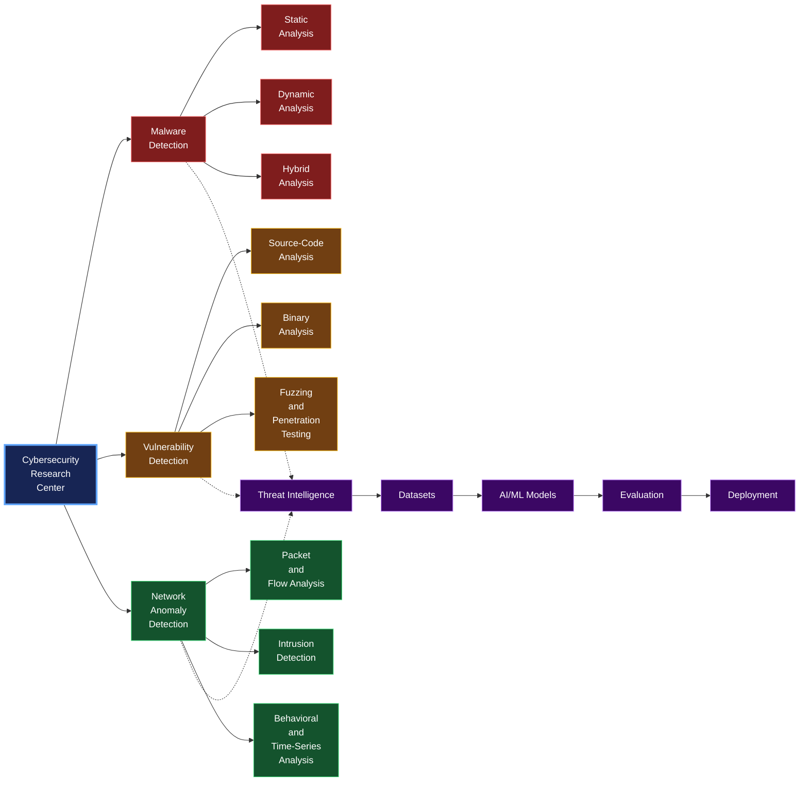

<h1 align="center">
  <a href="https://wikipedia.org/wiki/Computer_security" target="_blank">Cybersecurity</a>
  <em><strong><code>Research Center</code></strong></em>
</h1>

## Malware Detection Projects

### [`Android Malware`](https://github.com/cybersecurity-dev/awesome-android-malware-analysis) Detection

#### [Static](https://github.com/cybersecurity-dev/awesome-static-android-malware-analysis) Malware Detection
* [Static Android Malware Detection Scientific Research](https://github.com/cybersecurity-dev/awesome-static-android-malware-detection-scientific-research)

#### [Dynamic](https://github.com/cybersecurity-dev/awesome-dynamic-android-malware-analysis) Malware Detection
* [Dynamic Android Malware Detection Scientific Research](https://github.com/cybersecurity-dev/awesome-dynamic-android-malware-detection-scientific-research)

#### Malware Detection with Graph Representation Learning
* [Graph based Android Malware Detection](https://github.com/cybersecurity-dev/awesome-graph-based-android-malware-detection)
* [Graph based Android Malware Detection Scientific Research](https://github.com/cybersecurity-dev/awesome-graph-based-android-malware-detection-scientific-research)

---

### [`Linux Malware`](https://github.com/cybersecurity-dev/awesome-linux-malware-analysis) Detection

#### [Static](https://github.com/cybersecurity-dev/awesome-static-linux-malware-analysis) Malware Detection
* [Static Linux Malware Detection Scientific Research](https://github.com/cybersecurity-dev/awesome-static-linux-malware-detection-scientific-research)

#### [Dynamic](https://github.com/cybersecurity-dev/awesome-dynamic-linux-malware-analysis) Malware Detection
* [Dynamic Linux Malware Detection Scientific Research](https://github.com/cybersecurity-dev/awesome-dynamic-windows-malware-detection-scientific-research)

#### Malware Detection with Graph Representation Learning
* [Graph based Linux Malware Detection](https://github.com/cybersecurity-dev/awesome-graph-based-windows-malware-detection)
* [Graph based Linux Malware Detection Scientific Research](https://github.com/cybersecurity-dev/awesome-graph-based-windows-malware-detection-scientific-research)

---

### [`Windows Malware`](https://github.com/cybersecurity-dev/awesome-windows-malware-analysis) Detection

#### [Static](https://github.com/cybersecurity-dev/awesome-static-windows-malware-analysis) Malware Detection
* [Static Windows Malware Detection Scientific Research](https://github.com/cybersecurity-dev/awesome-static-windows-malware-detection-scientific-research)

#### [Dynamic](https://github.com/cybersecurity-dev/awesome-dynamic-windows-malware-analysis) Malware Detection
* [Dynamic Windows Malware Detection Scientific Research](https://github.com/cybersecurity-dev/awesome-dynamic-windows-malware-detection-scientific-research)

#### Malware Detection with Graph Representation Learning
* [Graph based Windows Malware Detection](https://github.com/cybersecurity-dev/awesome-graph-based-windows-malware-detection)
* [Graph based Windows Malware Detection Scientific Research](https://github.com/cybersecurity-dev/awesome-graph-based-windows-malware-detection-scientific-research)

---

### [`Fileless Malware`](https://github.com/cybersecurity-dev/awesome-fileless-malware) Detection

* [Fileless Malware Cookbook](https://github.com/cybersecurity-dev/Fileless-Malware-Cookbook)
* [Fileless Malware Resources](https://github.com/cybersecurity-dev/awesome-fileless-malware-resources)
* [Fileless Malware Scientific Research](https://github.com/cybersecurity-dev/awesome-fileless-malware-scientific-research)

---

### [`Network-based`](https://github.com/cybersecurity-dev/awesome-malware-traffic-analysis) Malware Detection

* [Flow-level Malware Detection Scientific Research](https://github.com/cybersecurity-dev/awesome-flow-level-malware-detection-scientific-research)
* [Malware Traffic Analysis](https://github.com/cybersecurity-dev/awesome-malware-traffic-analysis)
* [Malware Traffic Analysis Scientific Research](https://github.com/cybersecurity-dev/awesome-malware-traffic-analysis-scientific-research)

---

### Advanced Persistent Threat ([`APT`](https://github.com/cybersecurity-dev/awesome-advanced-persistent-threat)) Malware Detection

* [Advanced Persistent Threat Resources](https://github.com/cybersecurity-dev/awesome-advanced-persistent-threat-resources)
* [Advanced Persistent Threat Scientific Research](https://github.com/cybersecurity-dev/awesome-advanced-persistent-threat-scientific-research)

---
---

## Vulnerability Detection Scientific Research

---
---

## Smart Contract Scientific Research

---
---

## Network Anomaly Detection Scientific Research

---
---
---
